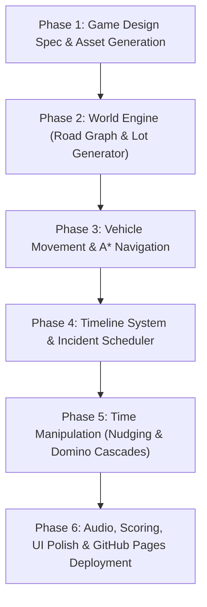

# Chronos Dispatch (Working Title: Time Management Game)
**Game Design Document & Technical Blueprint**

---

## 1. Executive Summary & Core Hook

* **Genre**: Time-Loop Tactical Dispatch / Emergency Puzzle
* **Tagline**: *"You don't travel through time. You choreograph when facts happen."*
* **Platform**: Browser-native (HTML5 / TypeScript / Canvas & Reactive Web UI)
* **Inspirations**: *Into the Breach* (forecasting & cascading cause-and-effect), *Mini Motorways* (clean road network & vehicle flow), *911 Operator* (emergency triage), *Groundhog Day* (the satisfying loop of mental mastery).

### The Pitch
You are an omniscient emergency dispatcher tasked with saving a neighborhood across a repeating one-hour window (08:00 AM – 09:00 AM). On your first run, disaster strikes: fires rage out of control, roads clog, and your limited response units are hopelessly overwhelmed. 

Every run follows the exact same baseline schedule of events. By learning the sequence, pre-positioning units, and using a scarce resource to **nudge event timings on a bottom timeline**, you orchestrate the perfect response to stop cascading catastrophes before they even begin.

---

## 2. Core Gameplay Loop

```
┌─────────────────────────────────────────────────────────────────┐
│                       1. THE RECON RUN                          │
│  Watch 08:00–09:00 unfold. Fail calls. Discover the schedule.   │
└────────────────────────────────┬────────────────────────────────┘
                                 │
                                 ▼
┌─────────────────────────────────────────────────────────────────┐
│                     2. INTEL & STRATEGY                         │
│  Note key timestamps: "Oak St kitchen fire starts at 08:04."    │
│  "Elm & 4th intersection jams at 08:12."                        │
└────────────────────────────────┬────────────────────────────────┘
                                 │
                                 ▼
┌─────────────────────────────────────────────────────────────────┐
│                     3. CHOREOGRAPH & EXECUTE                    │
│  • Pre-position Fire Engine near Oak at 08:02.                  │
│  • Spend a "Nudge Token" to delay the 08:05 gas leak by 3 mins. │
│  • Send Police to clear the intersection early.                 │
└────────────────────────────────┬────────────────────────────────┘
                                 │
                                 ▼
┌─────────────────────────────────────────────────────────────────┐
│                     4. EVALUATION & VICTORY                     │
│  Score based on: Casualties, Property Damage, Response Times.   │
│  Hit the target grade (Rank A/S) to advance to the next Seed!   │
└─────────────────────────────────────────────────────────────────┘
```

---

## 3. The Dual Mechanics of Time Control

### A. Direct Timeline Manipulation ("Nudging")
* Along the bottom of the screen lies the **Incident Timeline** spanning 08:00 to 09:00.
* Discovered incidents appear as cards on the track.
* Players have a limited currency called **Time Tokens (or "Dispatch Credibility")** (e.g., 3 tokens per run).
* A player can grab eligible events and slide them left or right by up to 3–5 minutes.
  * *Example*: Delaying an 08:06 call to 08:09 gives your Fire Engine just enough time to finish refilling water from an earlier blaze.
* **Immovable Events**: Weather events, scheduled train crossings, and school release bells cannot be nudged.

### B. Causal Domino Effects ("The Butterfly Effect")
Unresolved emergencies mutate dynamically:
```
08:04 Kitchen Fire (Ignored)
  └─► 08:09 Structure Fully Engulfed
        ├─► 08:13 Neighboring House Catches Fire
        └─► 08:16 Power Line Collapses onto Street
              └─► 08:18 Traffic Light Dies at Main Intersection
                    └─► 08:21 Multi-Car Pileup (Blocks Ambulance)
```
Stopping the initial incident snuffs out the entire branch of future disasters.

---

## 4. World Architecture: Modular Lots & Road Graph

To balance infinite variety with time-loop mastery, levels are **Seed-Based**:
* **Seed-Generated**: When entering a new district, a seed generates a unique layout of 15–25 building lots and interconnecting roads.
* **Static While Looping**: The layout, lots, and baseline schedule remain **100% identical** across every reset of that district until beaten.

### Lot Archetypes & Hazard Profiles
| Lot Type | Visuals | Typical Inherent Hazards |
| :--- | :--- | :--- |
| **Residential** | Houses, small apartments, lawns | Kitchen/grease fires, electrical shorts, medical distress. Low traffic. |
| **Commercial** | Diners, gas stations, supermarkets | Armed robberies, grease fires, delivery truck delivery jams. |
| **Civic / School** | Elementary school, town hall, park | School crossing pedestrian surges, playgrounds falls. Road bottlenecks. |
| **Industrial** | Factories, warehouses, chemical tanks | Chemical leaks, transformer explosions, structural collapses. |
| **Stations (Base)** | Police HQ, Firehouse, Hospital | Starting spawn points and refuel/turnaround points for responders. |

### The Road Network (Node-Edge Graph)
* Roads are defined as a graph of **Intersections (Nodes)** and **Street Segments (Edges)**.
* Each segment tracks:
  * Speed limit / travel distance.
  * Congestion level (Normal, Heavy, Blocked).
* Responders use fast $A^*$ pathfinding to navigate between lots and stations.

---

## 5. Response Units

| Unit | Speed | Specialty | Resource Constraints |
| :--- | :--- | :--- | :--- |
| 🚒 **Fire Engine** | Slow-Medium | Extinguishes fires, hazardous containment, physical rescues | Water capacity / duration at scene |
| 🚓 **Police Cruiser** | Fast | Crime deterrence, traffic control, scene investigation | Crowd control radius |
| 🚑 **Ambulance** | Medium-Fast | Medical triage, patient transport to hospital | Patient capacity (1 patient per trip) |

---

## 6. Visual Direction & Aesthetic

* **Style**: Stylized top-down isometric or crisp orthographic 2D (retro-tactical dispatch terminal meets modern clean vector art).
* **Palette**: Dark, high-contrast tactical backdrop (navy/slate blues, crisp asphalt grays) with vibrant status colors:
  * 🔴 Emergency Fire / Danger
  * 🔵 Police / Siren Blue
  * 🟢 Medical / Triage Green
  * 🟡 Road Alert / Caution
* **Screen Layout**:
  * **Top 70%**: The Neighborhood Map (interactive, clickable lots, moving vehicles with siren lights, rising smoke plumes).
  * **Bottom 30%**: The Interactive Timeline Scrubber (multi-track: Incidents, Road Closures, Active Dispatches, Play/Pause/2x/5x controls, Nudge tokens).

---

## 7. Asset Catalog to Create

### Category 1: Road & Environment Tiles
1. `road_straight_h` & `road_straight_v` (Horizontal & Vertical 2-lane roads)
2. `road_intersection_4way` (+ Crossroad)
3. `road_intersection_3way_t` (T-Junction, 4 rotations)
4. `road_corner` (90-degree bend, 4 rotations)
5. `road_deadend` (Cul-de-sac)
6. `ground_grass` & `ground_pavement` (Base background textures)

### Category 2: Building Lot Sprites (Top-Down / 2.5D Orthographic)
1. `lot_residential_house_a` & `lot_residential_house_b` (Suburban homes)
2. `lot_residential_apartment` (Multi-story residential)
3. `lot_commercial_diner` (Small roadside restaurant)
4. `lot_commercial_gas_station` (Pumps + mini-mart)
5. `lot_civic_school` (Schoolhouse with playground / crosswalk)
6. `lot_industrial_warehouse` (Industrial facility with smokestacks)
7. `lot_station_police` (Police Precinct)
8. `lot_station_fire` (Fire Station with bays)
9. `lot_station_hospital` (Medical center with emergency bay)

### Category 3: Vehicles (Top-Down Sprites, with siren variations)
1. `vehicle_fire_engine` (Red ladder/pumper truck)
2. `vehicle_police_cruiser` (Black & white patrol car)
3. `vehicle_ambulance` (White/yellow medical van)
4. `vehicle_civilian_car_a` & `vehicle_civilian_car_b` (Traffic cars)

### Category 4: Incident, UI & Status Icons
1. `icon_fire` (Flame / burning structure)
2. `icon_medical` (Heartbeat / medical cross)
3. `icon_police` (Badge / siren / shield)
4. `icon_traffic_jam` (Caution cones / hazard sign)
5. `icon_timeline_token` (Hourglass / temporal cog badge)
6. `fx_smoke_puff` & `fx_fire_flame` (Animated or static hazard overlays)

---

## 8. Implementation Roadmap


